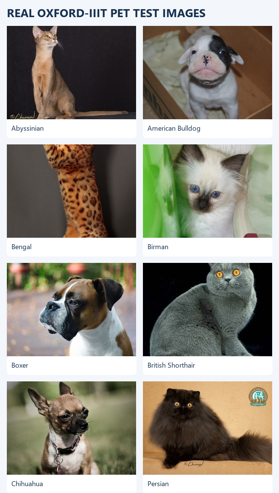
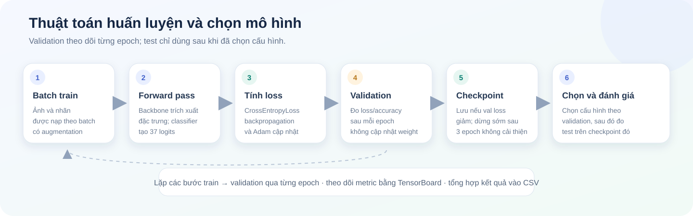
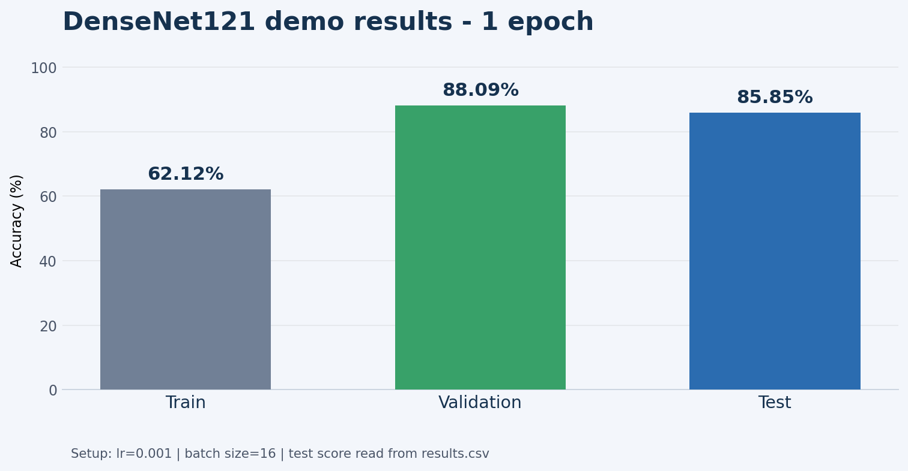

<div align="center">

# Transfer Learning for Pet Breed Classification

### Ứng dụng học chuyển giao (VGG16, DenseNet121) để phân loại 37 giống chó, mèo trên Oxford-IIIT Pet

**Thực hành 2 · CNN & Transfer Learning · Nhóm 10**


| 37 lớp | 7,349 ảnh | 4 cấu hình | 91.31% |
|:---:|:---:|:---:|:---:|
| giống chó và mèo | train · validation · test | 2 mô hình × 2 learning rate | test accuracy của DenseNet121 |

📓 [Notebook báo cáo](notebooks/bao_cao_thuc_hanh_2_transfer_learning.ipynb) · 🌐 [Báo cáo HTML](notebooks/bao_cao_thuc_hanh_2_transfer_learning.html) · 📊 [Kết quả CSV](outputs/reduced-experiments/results.csv)

</div>



---

## Mục lục

1. [Tổng quan](#1-tổng-quan)
2. [Đăng ký đề tài](#2-đăng-ký-đề-tài)
3. [Workflow của hệ thống](#3-workflow-của-hệ-thống)
4. [Dữ liệu và tiền xử lý](#4-dữ-liệu-và-tiền-xử-lý)
5. [Mô hình và thuật toán](#5-mô-hình-và-thuật-toán)
6. [Kết quả và so sánh với baseline](#6-kết-quả-và-so-sánh-với-baseline)
7. [Phân tích lỗi và giới hạn](#7-phân-tích-lỗi-và-giới-hạn)
8. [Demo](#8-demo)
9. [Cấu trúc dự án](#9-cấu-trúc-dự-án)
10. [Cài đặt và chạy](#10-cài-đặt-và-chạy)
11. [Kế hoạch và rủi ro](#11-kế-hoạch-và-rủi-ro)
12. [Tài liệu liên quan](#12-tài-liệu-liên-quan)

## 1. Tổng quan

Dự án áp dụng **transfer learning** để nhận dạng giống thú cưng. Thay vì khởi tạo một mạng mới và học tất cả tham số từ đầu, nhóm dùng các mô hình đã được huấn luyện trên ImageNet, thay lớp phân loại cuối thành 37 lớp, rồi huấn luyện trên Oxford-IIIT Pet.

| Vai trò | Mô hình | Đặc điểm |
| --- | --- | --- |
| **Baseline** | VGG16 | Các tầng tích chập xếp tuần tự, cấu trúc dễ theo dõi; dùng làm mô hình đối chiếu |
| **Giải pháp** | DenseNet121 | Các dense block truyền và tái sử dụng đặc trưng giữa nhiều tầng |

Trong cấu hình mặc định, backbone pretrained được đóng băng và chỉ classifier mới được cập nhật. Validation được dùng để chọn checkpoint và cấu hình; tập test chỉ được dùng để đánh giá sau khi đã chọn.

| Hạng mục | Thiết lập |
| --- | --- |
| Số lớp | 37 giống chó và mèo |
| Backbone | VGG16, DenseNet121 pretrained trên ImageNet |
| Learning rate đã chạy | 0.01 và 0.001 |
| Batch size trong kết quả hiện tại | 16 |
| Epoch tối đa | 5 |
| Early stopping | Patience = 3 |
| Loss / optimizer | CrossEntropyLoss / Adam |
| Seed | 42 |

## 2. Đăng ký đề tài

Tóm tắt theo mẫu đăng ký đề tài; nội dung chi tiết nằm trong Phần I của [notebook](notebooks/bao_cao_thuc_hanh_2_transfer_learning.ipynb).

| # | Mục | Nội dung |
|:---:|---|---|
| 1 | Tên đề tài | Ứng dụng học chuyển giao (VGG16, DenseNet121) để phân loại 37 giống chó, mèo trên bộ dữ liệu Oxford-IIIT Pet |
| 2 | Hướng chính | **Thị giác máy tính · Transfer Learning** — dùng VGG16 và DenseNet121 pretrained trên ImageNet, thay lớp phân loại cuối thành 37 lớp và so sánh kết quả trên cùng bộ dữ liệu. Chưa triển khai ứng dụng thời gian thực |
| 3 | Người sử dụng và vấn đề | Sinh viên, giảng viên học và đánh giá quy trình transfer learning; người xem demo/thuyết trình xem quy trình và kết quả so sánh. Nhiều giống trông gần giống nhau nên phân biệt bằng mắt có thể khó; mô hình chỉ để tham khảo trong phạm vi học tập |
| 4 | Mục tiêu | Pipeline 37 lớp chạy được với cả hai mô hình; so sánh DenseNet121 với baseline VGG16 và LR 0.01 với 0.001. Chỉ số: validation loss/accuracy để chọn, test loss/accuracy để đánh giá cuối. Không đặt trước ngưỡng accuracy |
| 5 | Dữ liệu | Oxford-IIIT Pet; mỗi mẫu là một ảnh + nhãn giống; 7,349 ảnh; giấy phép CC BY-SA 4.0. Chưa thử bộ dữ liệu khác (xem [mục 4](#4-dữ-liệu-và-tiền-xử-lý)) |
| 6 | Phạm vi | **Bắt buộc (đã làm):** 2 mô hình pretrained, LR 0.01/0.001, TensorBoard, chọn bằng validation. **Mở rộng (chưa làm):** fine-tune khối cuối, batch size 32, nhiều seed/k-fold, confusion matrix, ứng dụng/API |
| 7 | Phương pháp | Baseline VGG16, giải pháp DenseNet121; cùng dữ liệu, tiền xử lý, loss, optimizer và cách chọn cấu hình |
| 8 | Sản phẩm | Mã nguồn `src/`, notebook + báo cáo HTML, `results.csv`, hình trong `bao_cao_hinh_anh/`. Chưa có ứng dụng/API |
| 9 | Đánh giá | Loss và accuracy; 4 cấu hình; train / validation / test = 2,941 / 739 / 3,669 ảnh |
| 10 | Kế hoạch và rủi ro | Xem [mục 11](#11-kế-hoạch-và-rủi-ro) |

## 3. Workflow của hệ thống

Sơ đồ dưới đây tóm tắt cách dữ liệu đi qua pipeline, từ lúc kiểm tra split đến khi báo cáo kết quả.


### Các bước chính

1. Nạp các split `train`, `val`, `test` đã chuẩn bị; kiểm tra thư mục, ảnh và tính nhất quán của tên lớp.
2. Augmentation ngẫu nhiên chỉ áp dụng cho ảnh train; validation và test dùng transform cố định.
3. Khởi tạo từng backbone bằng trọng số ImageNet và thay classifier cuối theo số lớp.
4. Huấn luyện, ghi loss/accuracy và lưu checkpoint khi validation loss giảm.
5. Chọn cấu hình bằng validation, sau đó đánh giá cấu hình được chọn trên test.

## 4. Dữ liệu và tiền xử lý

Oxford-IIIT Pet gồm 37 giống chó và mèo. Dữ liệu được tổ chức theo định dạng `ImageFolder`: mỗi thư mục con tương ứng với một lớp. Mỗi mẫu gồm **một ảnh** và **nhãn giống** (tên thư mục lớp); project chỉ dùng ảnh và nhãn giống.

| Split | Số ảnh | Ảnh mỗi lớp | Cách sử dụng |
| --- | ---: | ---: | --- |
| Train | 2,941 | 74–80 | Cập nhật tham số mô hình |
| Validation | 739 | 19–20 | Theo dõi quá trình học và chọn checkpoint/cấu hình |
| Test | 3,669 | 88–100 | Đánh giá cuối cho cấu hình đã chọn |


- **Cách chia:** theo thông tin chuẩn bị dữ liệu được ghi nhận, train/validation được tách phân tầng 80/20 từ split `trainval`, còn test dùng split chính thức. Mã nguồn hiện tại chỉ nạp các thư mục split có sẵn, không tạo hoặc chia lại dữ liệu; do đó không thể xác minh độc lập cách chia này từ code.
- **Kiểm tra chất lượng:** không phát hiện file ảnh không đọc được. Kiểm tra SHA-256 không phát hiện ảnh trùng byte-identical giữa các split; cách này không phát hiện ảnh đã đổi định dạng/nén lại hoặc ảnh gần giống.
- **Validation:** sau mỗi epoch, chương trình tính loss và accuracy trên 739 ảnh của `val`; checkpoint được lưu khi validation loss giảm, early stopping theo dõi validation loss. Validation không cập nhật trọng số; test không tham gia chọn cấu hình.
- **Nguồn và quyền sử dụng:** [trang chính thức Oxford-IIIT Pet](https://www.robots.ox.ac.uk/~vgg/data/pets/), giấy phép [CC BY-SA 4.0](https://creativecommons.org/licenses/by-sa/4.0/); bản quyền ảnh vẫn thuộc các chủ sở hữu gốc. Dữ liệu không có trong repository (`dataset/` nằm trong `.gitignore`).
- **Phương án thay thế:** chưa thử bộ dữ liệu khác. Code đọc theo `ImageFolder` và lấy số lớp từ số thư mục, nên có thể dùng bộ dữ liệu khác có cùng cấu trúc `train/val/test/<lớp>`.

### Tiền xử lý ảnh

| Split | Phép biến đổi |
| --- | --- |
| Train | Resize 256 → `RandomResizedCrop(224)` → `RandomHorizontalFlip` → ToTensor → Normalize |
| Train-eval / Validation / Test | Resize 256 → `CenterCrop(224)` → ToTensor → Normalize |

Tất cả được chuẩn hóa theo thống kê ImageNet:

```text
mean = (0.485, 0.456, 0.406)
std  = (0.229, 0.224, 0.225)
```

Các transform và DataLoader được định nghĩa trong [`src/data_loader.py`](src/data_loader.py).

## 5. Mô hình và thuật toán

### Transfer learning

Ảnh đầu vào đi qua backbone để tạo đặc trưng. Classifier cuối chuyển đặc trưng thành 37 logits, tương ứng với điểm dự đoán cho từng giống. Trong lúc train, `CrossEntropyLoss` đo sai khác giữa dự đoán và nhãn thật; Adam cập nhật các tham số đang được mở train (`requires_grad=True`). Phần khởi tạo nằm trong [`src/main.py`](src/main.py); vòng lặp ở [`src/engine.py`](src/engine.py) thực hiện cho mỗi batch:

```python
logits = model(images)
loss = criterion(logits, labels)
loss.backward()
optimizer.step()
```

`loss.backward()` tính gradient từ lỗi; `optimizer.step()` dùng gradient đó để cập nhật tham số trainable. Trong validation/test, optimizer không được truyền vào vòng lặp nên trọng số không bị cập nhật.

Với cấu hình mặc định, các tầng trích xuất đặc trưng pretrained bị đóng băng để hạn chế số tham số cần cập nhật. Tùy chọn `--fine-tune-last-block` có thể mở thêm khối đặc trưng cuối, nhưng không được dùng trong các kết quả bên dưới.

### So sánh hai backbone

| Mô hình | Thay classifier | Trainable / tổng tham số |
| --- | --- | ---: |
| VGG16 (baseline) | `classifier[6]` → `Linear(4096, 37)`; đóng băng `features` và `classifier[:6]` | 151,589 / 134,412,133 |
| DenseNet121 | `classifier` → `Linear(1024, 37)`; đóng băng `features` | 37,925 / 6,991,781 |

Số tham số là số đo theo cấu hình model hiện tại; số lượng thấp hơn không tự động có nghĩa là chạy nhanh hơn. Dự án chưa đo thời gian và bộ nhớ đối chứng giữa hai mô hình. Chi tiết trong [`docs/model_analysis.md`](docs/model_analysis.md).

### Sơ đồ luồng qua hai mô hình


### Thuật toán huấn luyện



## 6. Kết quả và so sánh với baseline

Bốn cấu hình đã chạy gồm hai kiến trúc × hai learning rate (`0.01`, `0.001`); batch size giữ cố định ở 16. Mỗi kiến trúc chọn cấu hình theo validation loss thấp nhất, rồi mới đánh giá trên test.

| Mô hình | LR | Epoch tốt nhất / đã chạy | Val loss ↓ | Val accuracy ↑ | Test loss | Test accuracy | Chọn theo val |
| --- | ---: | :---: | ---: | ---: | ---: | ---: | :---: |
| VGG16 | 0.01 | 4 / 5 | 1.6225 | 87.96% | — | — | |
| **VGG16** | **0.001** | 4 / 5 | 0.2831 | 91.34% | 0.3450 | **88.80%** | ✅ |
| DenseNet121 | 0.01 | 1 / 4 | 0.4766 | 86.60% | — | — | |
| **DenseNet121** | **0.001** | 4 / 5 | 0.2767 | 91.88% | 0.3236 | **91.31%** | ✅ |

### DenseNet121 so với baseline VGG16 (LR 0.001, batch size 16)

| Chỉ số | VGG16 (baseline) | DenseNet121 | Chênh lệch |
| --- | ---: | ---: | ---: |
| Validation loss ↓ | 0.2831 | 0.2767 | −0.0063 |
| Validation accuracy ↑ | 91.34% | 91.88% | +0.54 điểm % |
| Test loss ↓ | 0.3450 | 0.3236 | −0.0213 |
| **Test accuracy ↑** | 88.80% | **91.31%** | **+2.51 điểm %** |
| Tổng tham số | 134,412,133 | 6,991,781 | — |


DenseNet121 tốt hơn baseline VGG16 ở cả bốn chỉ số trong lần chạy này. Cả hai mô hình đều chọn LR 0.001 vì validation loss thấp hơn LR 0.01. Kết quả chỉ phản ánh split, seed và cấu hình hiện tại; chưa đủ để kết luận mô hình nào luôn tốt hơn.

> Chỉ các cấu hình được chọn theo validation mới có test metrics. Các cấu hình còn lại không được đánh giá trên test để tránh dùng tập test làm tiêu chí chọn mô hình. Số liệu gốc: [`outputs/reduced-experiments/results.csv`](outputs/reduced-experiments/results.csv).

## 7. Phân tích lỗi và giới hạn

Project không lưu dự đoán theo từng ảnh, nên **chưa có** confusion matrix hay phân tích lỗi theo từng giống. Các nhận xét dưới đây chỉ dựa trên `results.csv`.

| Mô hình (được chọn) | Train-eval acc | Val acc | Train-eval − val | Test acc | Val − test | Ảnh test dự đoán sai |
| --- | ---: | ---: | ---: | ---: | ---: | ---: |
| VGG16 | 95.14% | 91.34% | 3.80 điểm % | 88.80% | 2.54 điểm % | 411 / 3,669 (11.20%) |
| DenseNet121 | 95.95% | 91.88% | 4.07 điểm % | 91.31% | 0.58 điểm % | 319 / 3,669 (8.69%) |

- **Generalization gap:** train-eval accuracy cao hơn validation 3.80 (VGG16) và 4.07 (DenseNet121) điểm phần trăm; train-eval loss cũng thấp hơn validation loss. Một split và một seed chưa đủ để khẳng định mô hình có hay không overfit.
- **Validation → test:** accuracy giảm 2.54 điểm với VGG16 và 0.58 điểm với DenseNet121; nguyên nhân chưa được phân tích.
- **Learning rate 0.01:** VGG16 có validation loss 1.6225 dù validation accuracy vẫn 87.96%; DenseNet121 đạt validation loss tốt nhất ở epoch 1 rồi dừng sớm ở epoch 4. Chọn theo validation loss đã loại cả hai cấu hình này.

### Giới hạn và hướng tiếp tục

- Mỗi kiến trúc được chạy với một seed và một split; nên chạy thêm seed hoặc k-fold để đánh giá độ ổn định.
- Batch size trong kết quả hiện tại chỉ là 16; chưa thể nhận xét ảnh hưởng của batch size 32.
- Thí nghiệm giới hạn tối đa 5 epoch và được chạy trên CPU; chưa đo thời gian/tài nguyên khi so sánh hai mô hình.
- Chưa có confusion matrix và precision/recall theo lớp để xem giống nào thường bị nhầm.
- SHA-256 chỉ phát hiện ảnh trùng byte-identical; có thể bổ sung perceptual hash để tìm ảnh gần giống.
- Bước chia train/validation không có trong mã nguồn.
- Repository chưa có event log TensorBoard và checkpoint; cần chạy lại thí nghiệm để tạo.

## 8. Demo

| Demo | Cách chạy | Cần dữ liệu |
| --- | --- | :---: |
| Đọc `results.csv`, vẽ bảng và biểu đồ so sánh | Mở notebook, chạy các ô ở mục 15–16 | Không |
| Kiểm tra split và nạp một batch thật bằng `create_dataloaders` | Mở notebook, chạy các ô ở mục 11 và 14 | Có |
| Huấn luyện nhanh 1 epoch để trình bày pipeline | Lệnh bên dưới | Có |

```bash
python src/main.py --data-dir dataset --models densenet121 --epochs 1 --batch-size 16 --learning-rate 0.001 --output-dir outputs/demo-densenet
```

Kết quả lần demo 1 epoch nhóm đã chạy trước đó (DenseNet121, LR 0.001, batch size 16):



> Đây là **demo 1 epoch cũ** dùng để kiểm tra pipeline, **không phải kết quả cuối**. Kết quả cuối ở [mục 6](#6-kết-quả-và-so-sánh-với-baseline).

## 9. Cấu trúc dự án

```text
BAI_E2/
├── bao_cao_hinh_anh/          # Ảnh mẫu, sơ đồ và biểu đồ kết quả
├── dataset/                   # (không có trong repo) train/ val/ test/ theo thư mục lớp
├── docs/                      # Báo cáo, hướng dẫn và phân tích
├── notebooks/
│   ├── bao_cao_thuc_hanh_2_transfer_learning.ipynb   # Notebook báo cáo
│   ├── bao_cao_thuc_hanh_2_transfer_learning.html    # Báo cáo HTML
│   └── check_dataset_duplicates.py                   # Kiểm tra ảnh trùng giữa các split
├── outputs/
│   └── reduced-experiments/
│       └── results.csv        # Kết quả 4 cấu hình (checkpoint/log được tạo khi chạy)
├── src/
│   ├── data_loader.py         # Transform và tạo DataLoader
│   ├── engine.py              # Vòng lặp train/evaluate và metrics
│   ├── main.py                # Chạy thí nghiệm, tuning và lưu kết quả
│   ├── models.py              # build_model() / count_parameters() dùng chung
│   ├── vgg16_model.py         # Triển khai VGG16
│   ├── densenet121_model.py   # Triển khai DenseNet121
│   └── tensorboard_logger.py  # Ghi scalar vào TensorBoard
├── tests/
│   └── test_tensorboard_logger.py
├── requirements.txt
└── README.md
```

| Tệp | Vai trò |
| --- | --- |
| `src/data_loader.py` | Đọc ảnh, augmentation, tạo DataLoader; kiểm tra tên lớp giữa các split |
| `src/models.py` | Điều phối `build_model()` và đếm tham số |
| `src/vgg16_model.py` | Khởi tạo VGG16, thay classifier và thiết lập fine-tuning |
| `src/densenet121_model.py` | Khởi tạo DenseNet121, thay classifier và thiết lập fine-tuning |
| `src/engine.py` | Train một epoch và tính loss/accuracy |
| `src/main.py` | Điều phối cấu hình, early stopping, chọn checkpoint, đánh giá test, ghi CSV |
| `src/tensorboard_logger.py` | Tạo event writer, ghi scalar metrics và flush log |
| `notebooks/check_dataset_duplicates.py` | Tìm ảnh trùng byte-identical giữa các split (SHA-256) |
| `tests/test_tensorboard_logger.py` | Kiểm thử các tag TensorBoard |

## 10. Cài đặt và chạy

Các lệnh sau chạy từ thư mục gốc của repository. Lần đầu tải trọng số pretrained cần Internet.

### Tạo môi trường và cài thư viện

<table>
<tr><th>Windows (PowerShell)</th><th>macOS / Linux</th></tr>
<tr><td>

```powershell
python -m venv .venv
.\.venv\Scripts\Activate.ps1
python -m pip install -r requirements.txt
```

</td><td>

```bash
python3 -m venv .venv
source .venv/bin/activate
python -m pip install -r requirements.txt
```

</td></tr>
</table>

Để mở notebook báo cáo cần thêm: `python -m pip install notebook matplotlib`.

### Chuẩn bị dữ liệu

Tải Oxford-IIIT Pet từ trang chính thức và sắp xếp như sau (code không tự chia dữ liệu; ba split phải có cùng 37 thư mục lớp):

```text
dataset/
├── train/<tên_giống>/*.jpg
├── val/<tên_giống>/*.jpg
└── test/<tên_giống>/*.jpg
```

Kiểm tra ảnh trùng giữa các split:

```bash
python notebooks/check_dataset_duplicates.py --data-dir dataset
```

### Chạy lại bốn cấu hình dùng trong báo cáo

Lệnh dưới đây chạy VGG16 và DenseNet121 với learning rate 0.01/0.001, batch size 16, tối đa 5 epoch. Kết quả được lưu vào thư mục mới để không ghi đè CSV/checkpoint hiện có.

```bash
python src/main.py --data-dir dataset --epochs 5 --patience 3 --batch-size 16 --tune --learning-rates 0.01 0.001 --batch-sizes 16 --seed 42 --output-dir outputs/reproduced
```

> Nếu bỏ `--batch-sizes 16`, chế độ `--tune` dùng mặc định batch size 16 và 32 (8 lần huấn luyện). Xem các tùy chọn khác bằng `python src/main.py --help`.

### Xem log TensorBoard

Mỗi cấu hình tạo event log riêng dưới thư mục `--output-dir`; log gồm loss/accuracy train, train-eval, validation, learning rate, batch size và test của cấu hình được chọn.

```bash
python -m tensorboard.main --logdir outputs/reproduced
```

Mở địa chỉ local được in ra (thường là `http://localhost:6006`). Trong Scalars, xem `Loss/train`, `Loss/train_eval`, `Loss/validation` và các tag `Accuracy/...`; test chỉ được ghi cho cấu hình đã chọn bằng validation.

> Hiện tại `outputs/reduced-experiments` chỉ có CSV kết quả, chưa có event log TensorBoard. Cần chạy thí nghiệm trước khi mở log.

### Chạy kiểm thử

```bash
python -m unittest discover -s tests
```

## 11. Kế hoạch và rủi ro

### Tiến độ thực hiện

| Công việc | Trạng thái |
|---|:---:|
| Chuẩn bị và kiểm tra dữ liệu | ✅ Hoàn thành |
| Xây dựng, chạy và so sánh hai mô hình | ✅ Hoàn thành |
| Đánh giá kết quả và hoàn thiện báo cáo | ✅ Hoàn thành |

Repository không ghi mốc thời gian cụ thể.

### Phụ thuộc, rủi ro và cách xử lý

| Phụ thuộc / rủi ro | Cách xử lý trong project |
|---|---|
| Dữ liệu phải chuẩn bị sẵn thành `train/val/test` | Kiểm tra tên lớp khớp giữa các split; kiểm tra ảnh trùng bằng SHA-256 |
| Tải trọng số pretrained lần đầu cần Internet | Ghi chú trong hướng dẫn cài đặt |
| Thời gian huấn luyện dài khi chạy trên CPU | Tối đa 5 epoch, early stopping patience 3, đóng băng backbone |
| Chọn mô hình bị thiên lệch theo test | Chọn bằng validation; test chỉ chạy cho cấu hình đã chọn |
| Overfitting | Augmentation ở train; theo dõi train-eval so với validation |
| Kết quả thay đổi theo split/seed | Cố định seed 42; ghi rõ là kết quả một lần chạy |

## 12. Tài liệu liên quan

- [Notebook báo cáo](notebooks/bao_cao_thuc_hanh_2_transfer_learning.ipynb)
- [Báo cáo HTML](notebooks/bao_cao_thuc_hanh_2_transfer_learning.html)
- [Phân tích mô hình](docs/model_analysis.md)
- [Workflow preview](docs/workflow_preview.md)
- [Báo cáo kiểm tra dữ liệu và mô hình](docs/data_model_validation.md)
- [Kết quả phân tích thực hành](docs/lab2_results_analysis.md)
- [Hướng dẫn kiểm tra yêu cầu](docs/lab2_requirements_checklist.md)
- [Báo cáo thuyết trình](docs/lab2_presentation_report.md)
