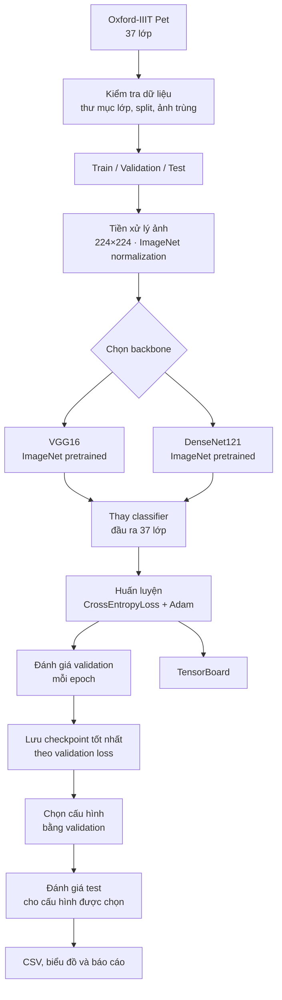
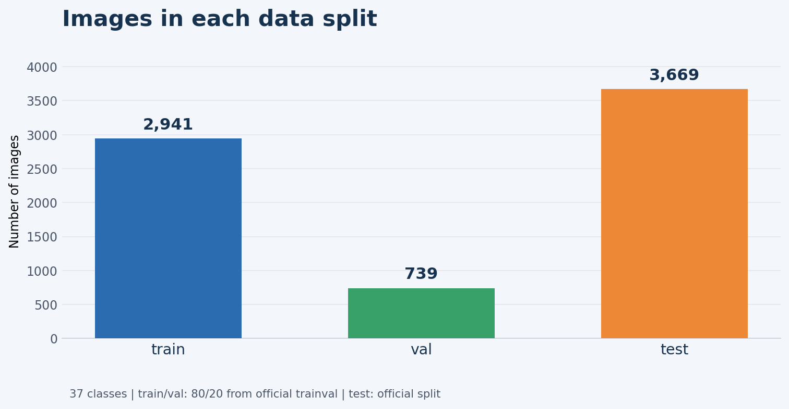
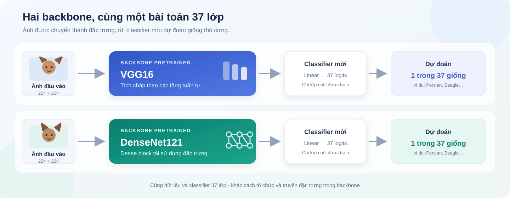
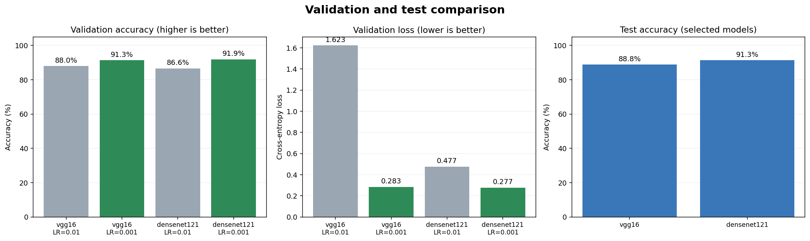

# Transfer Learning for Pet Breed Classification

### Thực hành 2 · CNN & Transfer Learning · Nhóm 10

> **Bài toán:** phân loại ảnh thành 37 giống chó và mèo  
> **Dữ liệu:** Oxford-IIIT Pet · **Mô hình:** VGG16 và DenseNet121  
> **Kết quả tốt nhất trong các cấu hình đã chạy:** DenseNet121 đạt **91.31% test accuracy**


---

## Mục lục

1. [Tổng quan](#1-tổng-quan)
2. [Workflow của hệ thống](#2-workflow-của-hệ-thống)
3. [Dữ liệu và tiền xử lý](#3-dữ-liệu-và-tiền-xử-lý)
4. [Mô hình và thuật toán](#4-mô-hình-và-thuật-toán)
5. [Kết quả thực nghiệm](#5-kết-quả-thực-nghiệm)
6. [Cấu trúc dự án](#6-cấu-trúc-dự-án)
7. [Cài đặt và chạy](#7-cài-đặt-và-chạy)
8. [Kế hoạch, phân công và giới hạn](#8-kế-hoạch-phân-công-và-giới-hạn)
9. [Tài liệu liên quan](#9-tài-liệu-liên-quan)

## 1. Tổng quan

Dự án áp dụng **transfer learning** để nhận dạng giống thú cưng. Thay vì khởi tạo một mạng mới và học tất cả tham số từ đầu, nhóm dùng các mô hình đã được huấn luyện trên ImageNet, thay lớp phân loại cuối thành 37 lớp, rồi huấn luyện trên Oxford-IIIT Pet.

Hai kiến trúc được đưa vào so sánh:

- **VGG16:** các tầng tích chập xếp tuần tự, cấu trúc dễ theo dõi.
- **DenseNet121:** các dense block truyền và tái sử dụng đặc trưng giữa nhiều tầng.

Trong cấu hình mặc định, backbone pretrained được đóng băng và chỉ classifier mới được cập nhật. Validation được dùng để chọn checkpoint; tập test chỉ được dùng để đánh giá sau khi đã chọn cấu hình.

| Hạng mục | Thiết lập |
| --- | --- |
| Số lớp | 37 giống chó và mèo |
| Backbone | VGG16, DenseNet121 pretrained trên ImageNet |
| Learning rate đã chạy | 0.01 và 0.001 |
| Batch size trong kết quả hiện tại | 16 |
| Epoch tối đa | 5 |
| Early stopping | Patience = 3 |
| Loss / optimizer | CrossEntropyLoss / Adam |

### Mục tiêu và đối tượng

| Nội dung | Mô tả |
|---|---|
| Mục tiêu | So sánh VGG16 và DenseNet121 cho bài toán phân loại 37 giống chó/mèo. |
| Người đọc/sử dụng | Sinh viên, giảng viên và người xem demo muốn tìm hiểu hoặc thử mô hình phân loại ảnh. |
| Vấn đề | Nhận diện nhiều giống bằng mắt có thể khó; mô hình được dùng để tham khảo trong phạm vi học tập, không thay thế đánh giá của con người. |

## 2. Workflow của hệ thống

Sơ đồ dưới đây tóm tắt cách dữ liệu đi qua pipeline, từ lúc kiểm tra split đến khi báo cáo kết quả.



### Các bước chính

1. Nạp các split `train`, `val`, `test` đã chuẩn bị; kiểm tra thư mục, ảnh và tính nhất quán của tên lớp.
2. Augmentation ngẫu nhiên chỉ áp dụng cho ảnh train; validation và test dùng transform cố định.
3. Khởi tạo từng backbone bằng trọng số ImageNet và thay classifier cuối theo số lớp.
4. Huấn luyện, ghi loss/accuracy và lưu checkpoint khi validation loss giảm.
5. Chọn cấu hình bằng validation, sau đó đánh giá cấu hình được chọn trên test.

## 3. Dữ liệu và tiền xử lý

Oxford-IIIT Pet gồm 37 giống chó và mèo. Dữ liệu được tổ chức theo định dạng `ImageFolder`: mỗi thư mục con tương ứng với một lớp.

| Split | Số ảnh | Cách sử dụng |
| --- | ---: | --- |
| Train | 2,941 | Cập nhật tham số mô hình |
| Validation | 739 | Theo dõi quá trình học và chọn checkpoint/cấu hình |
| Test | 3,669 | Đánh giá cuối cho cấu hình đã chọn |

Theo thông tin chuẩn bị dữ liệu được ghi nhận, train/validation được tách phân tầng 80/20 từ split `trainval`, còn test dùng split chính thức. Tuy nhiên, mã nguồn hiện tại chỉ nạp các thư mục split có sẵn, không tạo hoặc chia lại dữ liệu; do đó không thể xác minh độc lập cách chia này từ code. Kiểm tra SHA-256 không phát hiện ảnh trùng byte-identical giữa các split. Cách kiểm tra này không phát hiện ảnh đã đổi định dạng/nén lại hoặc ảnh gần giống.

**Validation:** thư mục `val` có 739 ảnh. Sau mỗi epoch, chương trình tính loss và accuracy trên tập này; checkpoint được lưu khi validation loss giảm, và early stopping theo dõi validation loss. Trong tuning, mỗi kiến trúc chọn cấu hình có validation loss thấp nhất; validation chỉ dùng để đánh giá, không cập nhật trọng số. Test không tham gia chọn cấu hình và chỉ được đánh giá sau khi lựa chọn xong.

Nguồn: [trang chính thức Oxford-IIIT Pet](https://www.robots.ox.ac.uk/~vgg/data/pets/). Dataset được cung cấp theo [CC BY-SA 4.0](https://creativecommons.org/licenses/by-sa/4.0/); bản quyền ảnh vẫn thuộc các chủ sở hữu gốc.



### Tiền xử lý ảnh

Ảnh được resize về 256, sau đó crop về 224×224. Ảnh train sử dụng `RandomResizedCrop` và `RandomHorizontalFlip`; validation/test dùng `CenterCrop` để phép đánh giá ổn định. Tất cả được chuẩn hóa theo thống kê ImageNet:

```text
mean = (0.485, 0.456, 0.406)
std  = (0.229, 0.224, 0.225)
```

Các transform và DataLoader được định nghĩa trong [`src/data_loader.py`](src/data_loader.py).

## 4. Mô hình và thuật toán

### Transfer learning

Ảnh đầu vào đi qua backbone để tạo đặc trưng. Classifier cuối chuyển đặc trưng thành 37 logits, tương ứng với điểm dự đoán cho từng giống. Trong lúc train, CrossEntropyLoss đo sai khác giữa dự đoán và nhãn thật; Adam cập nhật các tham số đang được mở train.

### CrossEntropyLoss và Adam làm gì?

Phần khởi tạo nằm trong [`src/main.py`](src/main.py): `CrossEntropyLoss` đo mức sai lệch giữa 37 logits và nhãn đúng; Adam được tạo với các tham số có `requires_grad=True`. Vòng lặp ở [`src/engine.py`](src/engine.py) thực hiện phép tính và cập nhật cho mỗi batch:

```python
logits = model(images)
loss = criterion(logits, labels)
loss.backward()
optimizer.step()
```

`loss.backward()` tính gradient từ lỗi; `optimizer.step()` dùng gradient đó để cập nhật tham số trainable. Trong validation/test, optimizer không được truyền vào vòng lặp nên trọng số không bị cập nhật.

Với cấu hình mặc định, các tầng trích xuất đặc trưng pretrained bị đóng băng để hạn chế số tham số cần cập nhật. Tùy chọn `--fine-tune-last-block` có thể mở thêm khối đặc trưng cuối, nhưng không được dùng trong các kết quả bên dưới.

### So sánh hai backbone

| Mô hình | Cách trích xuất đặc trưng | Trainable / tổng tham số |
| --- | --- | ---: |
| VGG16 | Các tầng tích chập nối tiếp; classifier cuối được thay cho 37 lớp | 151,589 / 134,412,133 |
| DenseNet121 | Dense block truyền và tái sử dụng đặc trưng giữa các tầng | 37,925 / 6,991,781 |

Số tham số là số đo theo cấu hình model hiện tại; số lượng thấp hơn không tự động có nghĩa là chạy nhanh hơn. Dự án chưa đo thời gian và bộ nhớ đối chứng giữa hai mô hình.

Chi tiết code và giải thích được trình bày trong [`docs/model_analysis.md`](docs/model_analysis.md).

### Sơ đồ luồng qua hai mô hình



### Thuật toán huấn luyện


## 5. Kết quả thực nghiệm

Bốn cấu hình đã chạy gồm hai kiến trúc × hai learning rate (`0.01`, `0.001`); batch size giữ cố định ở 16. Mỗi kiến trúc được chọn cấu hình theo validation loss thấp nhất, rồi mới đánh giá trên test.

| Mô hình được chọn | Learning rate | Batch size | Epoch tốt nhất / đã chạy | Validation loss | Validation accuracy | Test loss | Test accuracy |
| --- | ---: | ---: | ---: | ---: | ---: | ---: | ---: |
| VGG16 | 0.001 | 16 | 4 / 5 | 0.2831 | 91.34% | 0.3450 | 88.80% |
| DenseNet121 | 0.001 | 16 | 4 / 5 | 0.2767 | 91.88% | 0.3236 | 91.31% |



DenseNet121 cao hơn VGG16 **2.51 điểm phần trăm** về test accuracy trong lần chạy này. Kết quả chỉ phản ánh split và cấu hình hiện tại; chưa đủ để kết luận mô hình nào luôn tốt hơn trên các lần chia dữ liệu khác.

> Chỉ các cấu hình được chọn theo validation mới có test metrics trong bảng. Các cấu hình còn lại không được đánh giá trên test để tránh dùng tập test làm tiêu chí chọn mô hình.

Kết quả gốc được lưu tại [`outputs/reduced-experiments/results.csv`](outputs/reduced-experiments/results.csv).

## 6. Cấu trúc dự án

```text
BAI_E2/
├── bao_cao_hinh_anh/       # Ảnh mẫu, sơ đồ pipeline và biểu đồ kết quả
├── dataset/
│   ├── _oxford_raw/        # Dữ liệu Oxford-IIIT Pet gốc
│   ├── train/              # Ảnh train theo thư mục lớp
│   ├── val/                # Ảnh validation theo thư mục lớp
│   └── test/               # Ảnh test theo thư mục lớp
├── docs/                   # Báo cáo, hướng dẫn và phân tích
├── notebooks/              # Notebook báo cáo và script kiểm tra dữ liệu
├── outputs/                # CSV kết quả; checkpoint/log được tạo khi chạy thí nghiệm
├── src/
│   ├── data_loader.py      # Transform và tạo DataLoader
│   ├── engine.py           # Vòng lặp train/evaluate và metrics
│   ├── main.py             # Chạy thí nghiệm, tuning và lưu kết quả
│   ├── tensorboard_logger.py # Ghi scalar và hyperparameter vào TensorBoard
│   ├── models.py           # Giữ API build_model/count_parameters dùng chung
│   ├── vgg16_model.py      # Triển khai riêng mô hình VGG16
│   └── densenet121_model.py # Triển khai riêng mô hình DenseNet121
├── requirements.txt
└── README.md
```

| Tệp | Vai trò |
| --- | --- |
| `src/data_loader.py` | Đọc ảnh, augmentation và tạo DataLoader |
| `src/models.py` | Điều phối `build_model()` và đếm tham số; giữ tương thích với `main.py` |
| `src/vgg16_model.py` | Khởi tạo VGG16, thay classifier và thiết lập fine-tuning |
| `src/densenet121_model.py` | Khởi tạo DenseNet121, thay classifier và thiết lập fine-tuning |
| `src/engine.py` | Train một epoch và tính loss/accuracy |
| `src/main.py` | Điều phối cấu hình, chọn checkpoint và đánh giá |
| `src/tensorboard_logger.py` | Tạo event writer, ghi scalar metrics và flush log |
| `notebooks/bao_cao_thuc_hanh_2_transfer_learning.ipynb` | Báo cáo dạng notebook |

## 7. Cài đặt và chạy

Các lệnh sau chạy từ thư mục gốc của repository.

### Tạo môi trường và cài thư viện

```powershell
python -m venv .venv
.\.venv\Scripts\Activate.ps1
python -m pip install -r requirements.txt
```

### Chạy lại bốn cấu hình dùng trong báo cáo

Lệnh dưới đây chạy VGG16 và DenseNet121 với learning rate 0.01/0.001, batch size 16, tối đa 5 epoch. Kết quả được lưu vào thư mục mới để không ghi đè CSV/checkpoint hiện có.

```powershell
python src/main.py `
  --data-dir dataset `
  --epochs 5 `
  --patience 3 `
  --batch-size 16 `
  --tune `
  --learning-rates 0.01 0.001 `
  --batch-sizes 16 `
  --seed 42 `
  --output-dir outputs/reproduced
```

Để xem các tùy chọn khác:

```powershell
python src/main.py --help
```

### Xem log TensorBoard

Mã ghi log nằm trong [`src/tensorboard_logger.py`](src/tensorboard_logger.py). Khi chạy thí nghiệm, mỗi cấu hình tạo event log riêng dưới thư mục `--output-dir`; log gồm loss/accuracy train, train-eval, validation, learning rate, batch size và test của cấu hình được chọn. Theo lệnh tái chạy ở trên, log sẽ nằm trong `outputs/reproduced`.

```powershell
python -m tensorboard.main --logdir .\outputs\reproduced
```

Sau khi TensorBoard khởi động, mở địa chỉ local được in ra (thường là `http://localhost:6006`). Trong Scalars, xem `Loss/train`, `Loss/train_eval`, `Loss/validation` và các tag `Accuracy/...`; test chỉ được ghi cho cấu hình đã chọn bằng validation.

Hiện tại `outputs/reduced-experiments` có CSV kết quả nhưng chưa có event log TensorBoard. Cần chạy thí nghiệm trước khi mở log trên TensorBoard.

## 8. Kế hoạch, phân công và giới hạn

### Tiến độ thực hiện

| Công việc | Trạng thái |
|---|---|
| Chuẩn bị và kiểm tra dữ liệu | Hoàn thành |
| Xây dựng, chạy và so sánh hai mô hình | Hoàn thành |
| Đánh giá kết quả và hoàn thiện báo cáo | Hoàn thành |

Repository không ghi mốc thời gian cụ thể; nhóm có thể cập nhật lịch theo yêu cầu môn học.

### Phân công nhóm

| Thành viên | Nhiệm vụ | Mức độ hoàn thành |
|---|---|---|
|  |  |  |

### Giới hạn và hướng tiếp tục

- Mỗi kiến trúc được chạy với một seed và một split; nên chạy thêm seed hoặc k-fold để đánh giá độ ổn định.
- Batch size trong kết quả hiện tại chỉ là 16; chưa thể nhận xét ảnh hưởng của batch size 32.
- Thí nghiệm giới hạn tối đa 5 epoch và được chạy trên CPU; cần thêm phép đo thời gian/tài nguyên khi so sánh hiệu năng triển khai.
- SHA-256 chỉ phát hiện ảnh trùng byte-identical; có thể bổ sung perceptual hash để tìm ảnh gần giống.
- Có thể bổ sung confusion matrix và precision/recall theo lớp để xem giống nào thường bị nhầm.

## 9. Tài liệu liên quan

- [Báo cáo HTML](notebooks/bao_cao_thuc_hanh_2_transfer_learning.html)
- [Notebook báo cáo](notebooks/bao_cao_thuc_hanh_2_transfer_learning.ipynb)
- [Phân tích mô hình](docs/model_analysis.md)
- [Workflow preview](docs/workflow_preview.md)
- [Báo cáo kiểm tra dữ liệu và mô hình](docs/data_model_validation.md)
- [Kết quả phân tích thực hành](docs/lab2_results_analysis.md)
- [Hướng dẫn kiểm tra yêu cầu](docs/lab2_requirements_checklist.md)
- [Báo cáo thuyết trình](docs/lab2_presentation_report.md)
