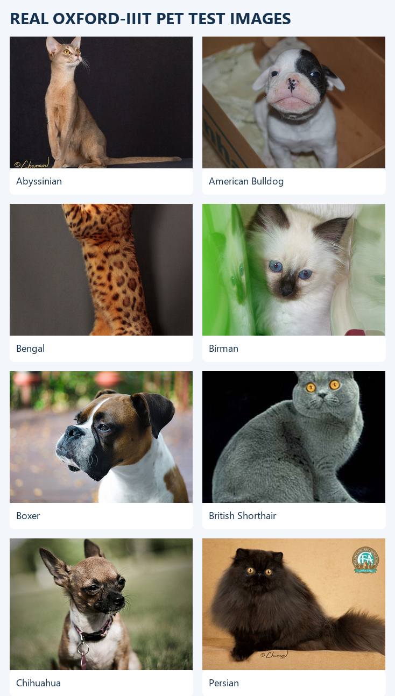
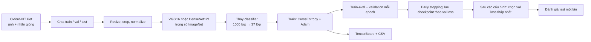
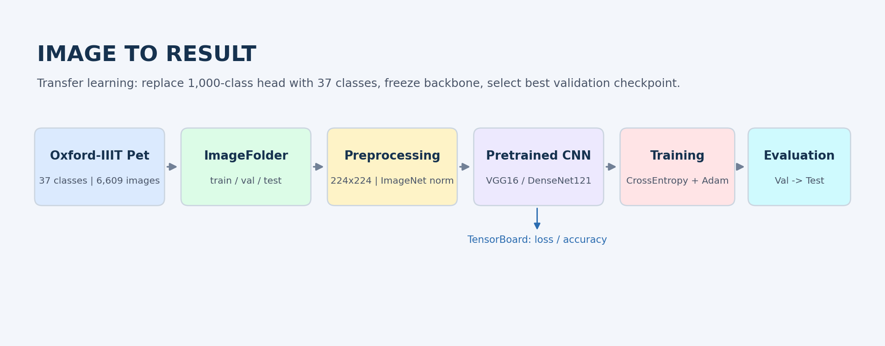
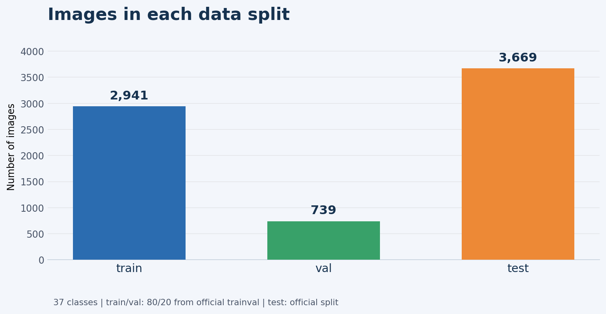
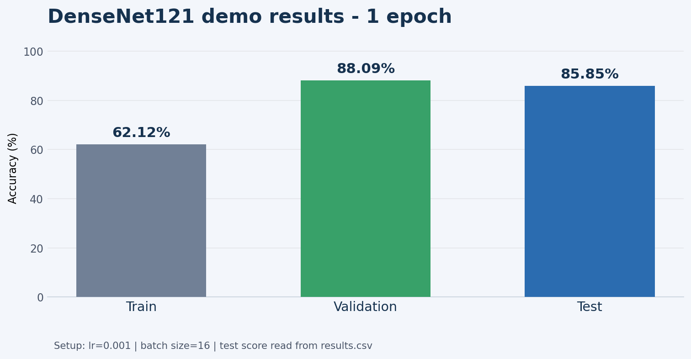

# Báo cáo thuyết trình – Thực hành 2
## Transfer Learning với VGG16 và DenseNet121

> **Bài toán:** phân loại 37 giống chó/mèo · **Dataset:** Oxford-IIIT Pet · **Mô hình:** DenseNet121, VGG16  
> Tài liệu gồm ảnh thật từ dataset, biểu đồ tạo từ số liệu chạy, các đoạn code chính và lời giải thích để dùng khi thuyết trình.



---

## Mở đầu: Bài toán và mục tiêu

**Bài toán:** phân loại ảnh thành một trong **37 giống chó/mèo** của Oxford-IIIT Pet.

**Mục tiêu thực hành:** dùng các mạng VGG16 và DenseNet121 đã được huấn luyện trước trên ImageNet, thay lớp phân loại cuối cho phù hợp với 37 lớp của bộ dữ liệu, sau đó huấn luyện và so sánh kết quả.

Đây là **transfer learning** (học chuyển giao): tận dụng các đặc trưng ảnh mô hình đã học thay vì huấn luyện toàn bộ mạng từ đầu. Nếu mở thêm một phần backbone đã đóng băng để nó học thích nghi với dữ liệu mới, quá trình đó gọi là **fine-tuning**.

### Luồng xử lý tổng quát





---

## 1. Thiết lập môi trường

Các thư viện chính được khai báo trong [`requirements.txt`](./requirements.txt):

| Thư viện | Vai trò |
| --- | --- |
| PyTorch | Tensor, mô hình, loss, optimizer và vòng lặp huấn luyện |
| torchvision | VGG/DenseNet, xử lý ảnh và các API dataset |
| TensorBoard | Ghi và hiển thị biểu đồ loss/accuracy |
| Pillow | Đọc ảnh |

Môi trường của dự án nằm trong `.venv`, dùng Python 3.12, PyTorch `2.14.1+cpu`, torchvision `0.29.1+cpu` và TensorBoard `2.21.0`. Máy đang dùng bản CPU, nên không có tăng tốc CUDA.

Kích hoạt trong PowerShell:

```powershell
.\.venv\Scripts\Activate.ps1
```

Hoặc gọi trực tiếp Python của môi trường:

```powershell
.\.venv\Scripts\python.exe main.py --help
```

**Tại sao dùng môi trường riêng?** `.venv` giữ thư viện của dự án tách khỏi Python toàn máy, giảm nguy cơ ảnh hưởng đến các project khác và giúp tái tạo phiên bản thư viện khi trình bày.

---

## 2. Dữ liệu lấy từ đâu?

### Nguồn dữ liệu

Dự án dùng **Oxford-IIIT Pet**, một bộ ảnh chó và mèo gồm **37 giống**. Bộ dữ liệu được tải qua `torchvision.datasets.OxfordIIITPet` từ kho dữ liệu của Oxford; các file nằm trong:

```text
dataset/
  _oxford_raw/   # dữ liệu gốc tải về
  train/         # dữ liệu train
  val/           # dữ liệu validation
  test/          # test chính thức
```

Các thư mục `train`, `val`, `test` được tổ chức theo định dạng mà `torchvision.datasets.ImageFolder` đọc được: mỗi thư mục con là tên một lớp.

### Cách chia và số lượng ảnh

| Split | Số ảnh | Cách tạo | Mục đích |
| --- | ---: | --- | --- |
| Train | 2.941 | Chia phân tầng 80% từ split `trainval` chính thức | Cập nhật trọng số mô hình |
| Validation | 739 | 20% còn lại của split `trainval`, giữ tỷ lệ từng lớp | Chọn epoch/checkpoint và theo dõi overfit |
| Test | 3.669 | Giữ nguyên split `test` chính thức | Đánh giá cuối cùng |



Train/validation được chia với seed `42` để có thể lặp lại cách chia. Test chính thức được để riêng, không dùng để chọn mô hình hay điều chỉnh siêu tham số.

Các ảnh trong split được **hard-link** đến bản ảnh gốc; cách này cho phép `ImageFolder` đọc ảnh theo thư mục lớp mà không tạo thêm một bản sao đầy đủ của ảnh trên ổ đĩa.

**Vì sao phải có ba split?**

- Nếu đánh giá trên ảnh đã huấn luyện, accuracy không phản ánh tốt khả năng dự đoán ảnh mới.
- Validation giúp chọn mô hình/checkpoint mà không “nhìn trước” vào test.
- Test chỉ dùng ở bước cuối để ước lượng chất lượng trên dữ liệu chưa dùng trong quá trình lựa chọn.

### Đoạn code quan trọng trong `data_loader.py`

```python
train_dataset = datasets.ImageFolder(
    split_paths["train"], transform=train_transform
)
val_dataset = datasets.ImageFolder(
    split_paths["val"], transform=evaluation_transform
)
test_dataset = datasets.ImageFolder(
    split_paths["test"], transform=evaluation_transform
)
```

`ImageFolder` tự suy ra nhãn từ tên thư mục lớp. Code còn kiểm tra các split có cùng tên/thứ tự lớp, để nhãn `class index` không bị lệch giữa train, validation và test.

### Tiền xử lý ảnh trong code

Đây là phần transform thực tế trong [`data_loader.py`](./data_loader.py):

```python
train_transform = transforms.Compose([
    transforms.Resize(256),
    transforms.RandomResizedCrop(224),
    transforms.RandomHorizontalFlip(),
    transforms.ToTensor(),
    transforms.Normalize(imagenet_mean, imagenet_std),
])

evaluation_transform = transforms.Compose([
    transforms.Resize(256),
    transforms.CenterCrop(224),
    transforms.ToTensor(),
    transforms.Normalize(imagenet_mean, imagenet_std),
])
```

`RandomResizedCrop` và `RandomHorizontalFlip` chỉ dùng khi train để augmentation. Validation/test dùng `CenterCrop` cố định để không làm kết quả thay đổi ngẫu nhiên giữa các lần đánh giá.

---

## 3. Tải mô hình pretrained và khám phá kiến trúc

### Pretrained có nghĩa là gì?

Trọng số pretrained đã được học từ trước trên ImageNet. Mạng thường đã học các đặc trưng tổng quát như cạnh, vùng màu, hoa văn và hình dạng. Dự án dùng các trọng số mặc định của torchvision:

```python
model = models.densenet121(
    weights=models.DenseNet121_Weights.DEFAULT
)
```

Với VGG16, code tương ứng là `models.vgg16(weights=models.VGG16_Weights.DEFAULT)`.

Lần đầu khởi tạo, torchvision có thể tải file trọng số ImageNet nếu máy chưa có cache. Đây là **trọng số của mô hình**, khác với bộ ảnh Oxford-IIIT Pet.

### Hai kiến trúc được thử

- **VGG16:** mạng tích chập có các khối convolution nối tiếp; dễ quan sát và là kiến trúc kinh điển, nhưng kích thước phần classifier tương đối lớn.
- **DenseNet121:** các lớp trong dense block truyền đặc trưng đến nhiều lớp sau; thường tái sử dụng đặc trưng hiệu quả hơn, nhưng việc huấn luyện vẫn tốn tài nguyên.

`main.py` in toàn bộ `model` khi bắt đầu mỗi thí nghiệm. Trong phần cuối của DenseNet có classifier dạng:

```text
(classifier): Linear(in_features=1024, out_features=37, bias=True)
```

`in_features=1024` là số đặc trưng DenseNet đưa ra trước classifier; `out_features=37` là số lớp của bài toán.

Đoạn khởi tạo và thay đầu ra trong [`models.py`](./models.py):

```python
model = models.densenet121(
    weights=models.DenseNet121_Weights.DEFAULT
)
in_features = model.classifier.in_features
model.classifier = nn.Linear(in_features, num_classes)
```

Đối với VGG16, classifier cuối là `model.classifier[6]`; đoạn code tạo lớp mới có cùng số đầu vào của classifier cũ nhưng chỉ xuất ra `num_classes` logits.

**Tại sao thử hai mô hình?** Đây là cách đáp ứng yêu cầu so sánh kiến trúc pretrained. Muốn so sánh công bằng, giữ dataset, cách chia, số epoch và cấu hình siêu tham số như nhau giữa các lần chạy.

---

## 4. Điều chỉnh mô hình cho bài toán mới

Mô hình ImageNet ban đầu phân loại 1.000 lớp. Oxford-IIIT Pet có 37 giống, vì vậy cần thay lớp cuối:

```python
in_features = model.classifier.in_features
model.classifier = nn.Linear(in_features, num_classes)
```

Với VGG16, lớp cuối nằm ở `model.classifier[6]`; với DenseNet121, classifier là `model.classifier`.

### Freeze và fine-tuning

Mặc định, code đóng băng backbone và chỉ cho classifier mới học:

```python
for parameter in backbone_parameters:
    parameter.requires_grad = False

for parameter in head_parameters:
    parameter.requires_grad = True
```

Điều này giảm số tham số phải cập nhật, giúp lượt thử ban đầu nhanh hơn và hạn chế làm hỏng các đặc trưng pretrained khi dữ liệu mới không quá lớn.

Nếu muốn cho khối cuối thích nghi với bộ dữ liệu mới, có thể thêm:

```powershell
--fine-tune-last-block
```

Khi bật, code mở một phần cuối của `features` ở VGG16 hoặc `denseblock4` và `norm5` ở DenseNet121. Fine-tuning có thể tăng khả năng thích nghi, nhưng tăng thời gian và nguy cơ overfit; nên so sánh bằng validation thay vì mặc định cho rằng sẽ tốt hơn.

Hàm `count_parameters()` in số tham số được huấn luyện so với tổng số tham số. Số này cho biết mức độ freeze/fine-tune đang áp dụng.

---

## 5. Tiền xử lý dữ liệu và DataLoader

### Kích thước và chuẩn hóa

Ảnh được đưa về vùng ảnh `224 × 224` và chuẩn hóa theo thống kê ImageNet:

```python
imagenet_mean = (0.485, 0.456, 0.406)
imagenet_std = (0.229, 0.224, 0.225)
```

**Vì sao?** Trọng số pretrained được học với cách tiền xử lý tương ứng. Dùng cùng kích thước và chuẩn hóa giúp ảnh đầu vào có phân phối phù hợp hơn với những gì mô hình đã học.

### Train khác validation/test

Train dùng phép biến đổi ngẫu nhiên:

```python
transforms.Resize(256),
transforms.RandomResizedCrop(224),
transforms.RandomHorizontalFlip(),
```

Đây là **data augmentation**: cùng một ảnh có thể được cắt/đảo khác nhau giữa các lần đọc, giảm việc mô hình ghi nhớ đúng từng ảnh huấn luyện.

Validation và test dùng phép biến đổi cố định:

```python
transforms.Resize(256),
transforms.CenterCrop(224),
```

Không dùng crop ngẫu nhiên ở validation/test để kết quả ít dao động và có thể so sánh giữa các epoch/cấu hình.

### Batch và shuffle

- Batch size mặc định là `16`: mỗi bước cập nhật xử lý 16 ảnh; đây là cấu hình khởi đầu để giới hạn bộ nhớ và thời gian trên máy CPU.
- Train bật `shuffle=True` để thứ tự mẫu thay đổi theo epoch.
- Validation/test dùng `shuffle=False` vì không cần xáo trộn khi đánh giá.
- `num_workers=0` được chọn mặc định để chạy đơn giản và ổn định trên Windows.
- Seed `42` giúp tái lập thứ tự shuffle của DataLoader.

Batch size `32` cũng có trong các cấu hình thử nghiệm để xem ảnh hưởng của số ảnh mỗi batch. Batch lớn hơn không đảm bảo accuracy cao hơn; nó làm tăng lượng bộ nhớ cần dùng và thay đổi số lần cập nhật trong mỗi epoch.

---

## 6. Huấn luyện mô hình

### Hàm mất mát: CrossEntropyLoss

```python
criterion = nn.CrossEntropyLoss()
```

Đầu ra của mạng là 37 điểm số (logits), mỗi điểm tương ứng một giống. `CrossEntropyLoss` so sánh các điểm số này với nhãn đúng dạng class index, phù hợp với phân loại nhiều lớp.

### Optimizer: Adam

```python
optimizer = torch.optim.Adam(
    (p for p in model.parameters() if p.requires_grad),
    lr=learning_rate,
)
```

Adam tự điều chỉnh bước cập nhật theo thống kê gradient, thường là lựa chọn tiện dụng để bắt đầu fine-tuning. Chỉ các tham số có `requires_grad=True` được đưa vào optimizer.

### Vòng lặp train

Trong [`engine.py`](./engine.py), mỗi batch thực hiện các bước cốt lõi:

```python
optimizer.zero_grad(set_to_none=True)
logits = model(images)
loss = criterion(logits, labels)
loss.backward()
optimizer.step()
```

Ý nghĩa:

1. Xóa gradient cũ.
2. Cho mô hình dự đoán.
3. Tính mức sai khác giữa dự đoán và nhãn.
4. Lan truyền sai số để tính gradient.
5. Adam cập nhật tham số đang được huấn luyện.

Phần đánh giá dùng chung vòng lặp nhưng không truyền optimizer, vì vậy không có cập nhật trọng số:

```python
def evaluate(model, loader, criterion, device):
    return _run_epoch(
        model, loader, criterion, device, optimizer=None
    )
```

Trong `_run_epoch`, `torch.set_grad_enabled(training)` tắt tính gradient khi đánh giá; điều này giảm tính toán không cần thiết.

Loss và accuracy của epoch được tính trên toàn bộ số mẫu, không lấy trung bình đơn giản các batch có thể khác kích thước.

Code in tiến độ mỗi 20 batch để người dùng thấy chương trình vẫn hoạt động. Với CPU, xử lý một epoch có thể lâu; terminal cần chạy đến hết validation/test để tạo CSV kết quả.

### Vì sao có validation sau mỗi epoch?

Validation cho biết mô hình hoạt động trên ảnh không dùng để cập nhật trọng số. Mỗi epoch, chương trình lưu checkpoint có validation loss thấp nhất:

```python
if val_metrics["loss"] < best_val_loss:
    best_val_loss = val_metrics["loss"]
    torch.save(best_state, checkpoint_path)
```

Mặc định, chương trình dừng sớm nếu validation loss không cải thiện trong 3 epoch liên tiếp (`--patience 3`), nhưng không chạy quá số epoch đặt bằng `--epochs`. Sau khi hoàn tất các mô hình/cấu hình, cấu hình có validation loss thấp nhất được chọn; chỉ checkpoint đó mới được đánh giá trên test một lần. Test không được dùng để chọn mô hình hay siêu tham số.

---

## 7. Siêu tham số: ý nghĩa và lý do chọn

| Tham số | Giá trị hiện tại/mặc định | Tại sao dùng và lưu ý |
| --- | --- | --- |
| `epochs` | Tối đa mặc định `5`; lần demo trong kết quả là `1` | Epoch là một lượt qua toàn bộ train. Một epoch chỉ phù hợp kiểm tra pipeline; có thể đặt `--epochs 20` cho thử nghiệm dài hơn. |
| `patience` | Mặc định `3` | Dừng khi validation loss không giảm trong 3 epoch liên tiếp. Early stopping không thay thế việc chọn số epoch tối đa. |
| `batch_size` | Mặc định `16`; đề xuất so với `32` | 16 là điểm bắt đầu thực tế cho CPU. 32 cho phép so sánh ảnh hưởng batch nhưng có thể cần thêm bộ nhớ và không đảm bảo chính xác hơn. |
| `learning_rate` | Mặc định `0.001`; đề bài gợi ý thử `0.01` và `0.001` | Learning rate quyết định độ lớn cập nhật. `0.001` là mức thử ban đầu thận trọng với Adam; `0.01` là cấu hình đối chiếu, có thể dao động mạnh hơn. Cần xem loss/validation để kết luận. |
| `seed` | `42` | Giúp cố định các yếu tố ngẫu nhiên của Python, PyTorch và thứ tự mẫu. Không đảm bảo kết quả tuyệt đối giống nhau trên mọi phần cứng. |
| `num_workers` | `0` | Dễ chạy trên Windows, tránh vấn đề tạo tiến trình con; có thể chậm hơn khi đọc dữ liệu. |
| `image_size` | `224` | Kích thước chuẩn thường dùng với các trọng số ImageNet của VGG/DenseNet. |

### Phạm vi tuning đã chạy

Đã chạy 4 cấu hình: VGG16 và DenseNet121, mỗi mô hình với learning rate `0.01` và `0.001`, batch size cố định `16`, tối đa 5 epoch và patience 3. Như vậy đã so sánh hai kiến trúc và ảnh hưởng của learning rate; **chưa so sánh batch size 16 với 32**. Kết quả lưu tại `outputs/reduced-experiments/results.csv`. Lượt chạy VGG16 `lr=0.01` trong `outputs/assignment-experiments` bị dừng giữa chừng và không dùng trong bảng kết quả.

---

## 8. Đánh giá và kết quả đã ghi nhận

Kết quả thực nghiệm mới trong `outputs/reduced-experiments/results.csv`:

| Mô hình | LR | Batch | Epoch tốt nhất / đã chạy | Train-eval accuracy tại checkpoint | Validation loss | Validation accuracy | Test loss | Test accuracy |
| --- | ---: | ---: | ---: | ---: | ---: | ---: | ---: | ---: |
| VGG16 | 0.01 | 16 | 4 / 5 | 0.9266 (92,66%) | 1.6225 | 0.8796 (87,96%) | — | — |
| VGG16 | 0.001 | 16 | 4 / 5 | 0.9514 (95,14%) | 0.2831 | 0.9134 (91,34%) | 0.3450 | 0.8880 (88,80%) |
| DenseNet121 | 0.01 | 16 | 1 / 4 | 0.8810 (88,10%) | 0.4766 | 0.8660 (86,60%) | — | — |
| DenseNet121 | 0.001 | 16 | 4 / 5 | 0.9595 (95,95%) | 0.2767 | 0.9188 (91,88%) | 0.3236 | 0.9131 (91,31%) |

Mỗi kiến trúc được chọn riêng bằng validation loss; vì vậy test chỉ có kết quả cho cấu hình thắng của từng kiến trúc. `—` nghĩa là cấu hình đó không được đánh giá trên test. Với cả hai mô hình, `lr=0.001` có validation loss thấp hơn `lr=0.01` trong thí nghiệm này. DenseNet121 có test accuracy cao hơn VGG16 ở cấu hình được chọn, nhưng đây chỉ là một lần chạy với seed cố định, không phải kết quả trung bình.

Chênh lệch train-eval và validation accuracy tại checkpoint được chọn khoảng 3,80 điểm phần trăm với VGG16 và 4,07 điểm phần trăm với DenseNet121. Đây là khoảng cách quan sát được, không đủ để khẳng định mô hình hoàn toàn không overfit; train-eval loss cũng thấp hơn validation loss ở cả hai mô hình.

### So sánh VGG16 và DenseNet121

So sánh dưới đây dùng cấu hình được chọn riêng cho mỗi kiến trúc bằng validation loss (learning rate `0.001`, batch size `16`), sau đó đánh giá trên cùng test split:

| Tiêu chí | VGG16 | DenseNet121 | Nhận xét |
| --- | ---: | ---: | --- |
| Validation accuracy | 91,34% | 91,88% | DenseNet121 cao hơn 0,54 điểm phần trăm |
| Validation loss | 0,2831 | 0,2767 | DenseNet121 thấp hơn nhẹ |
| Test accuracy | 88,80% | 91,31% | DenseNet121 cao hơn 2,51 điểm phần trăm |
| Test loss | 0,3450 | 0,3236 | DenseNet121 thấp hơn 0,0214 |
| Tổng tham số | 134.412.133 | 6.991.781 | DenseNet121 có tổng tham số ít hơn đáng kể |
| Tham số được huấn luyện | 151.589 | 37.925 | Cả hai lần chạy đều đóng băng backbone, chỉ cập nhật classifier mới |

**Ưu điểm của VGG16:** kiến trúc tuần tự, đơn giản và dễ giải thích; là mô hình đối chiếu phổ biến. Trong thí nghiệm này, validation accuracy đạt 91,34%, nhưng test accuracy thấp hơn DenseNet121.

**Nhược điểm của VGG16:** tổng số tham số lớn hơn nhiều, nên thường đòi hỏi nhiều bộ nhớ lưu trữ và chi phí triển khai cao hơn. Dù đã đóng băng phần lớn tham số, kết quả test của cấu hình được chọn vẫn thấp hơn DenseNet121 trong lần chạy này.

**Ưu điểm của DenseNet121:** các khối kết nối dày đặc tái sử dụng đặc trưng giữa các lớp; tổng tham số của mô hình nhỏ hơn VGG16 đáng kể. Trong thí nghiệm này, DenseNet121 có validation loss thấp hơn và test accuracy cao hơn 2,51 điểm phần trăm.

**Nhược điểm của DenseNet121:** luồng nối/tái sử dụng feature map làm kiến trúc và luồng tính toán phức tạp hơn VGG16; số tham số ít hơn không đồng nghĩa chắc chắn chạy nhanh hơn trên mọi phần cứng. Thời gian chạy và mức dùng bộ nhớ của từng mô hình chưa được đo đối chiếu riêng trong kết quả này.

**Kết luận có giới hạn:** với Oxford-IIIT Pet, split, seed và cấu hình đã thử, DenseNet121 là lựa chọn tốt hơn theo test accuracy và test loss. Chênh lệch này là kết quả của một lần chạy, không có nhiều seed hoặc k-fold để ước lượng độ biến thiên; do đó không khẳng định DenseNet121 luôn tốt hơn trên dữ liệu khác.



Hình trên là minh họa **demo một epoch cũ**, không phải biểu đồ của 4 cấu hình mới. Dùng TensorBoard trong `outputs/reduced-experiments` để trình bày các đường cong của lần chạy tuning.

### Cách tính accuracy

```text
accuracy = số ảnh dự đoán đúng / tổng số ảnh
```

Ví dụ `0.9131` tương đương khoảng 91,31% ảnh test được phân loại đúng. Loss càng thấp thường cho thấy dự đoán càng phù hợp với nhãn, nhưng cần xem chung với accuracy và các đường train/validation.

---

## 9. TensorBoard và file đầu ra

Trong `main.py`, mỗi epoch ghi:

- `Loss/train`, `Accuracy/train`: metric trong lúc train, trên ảnh có augmentation
- `Loss/train_eval`, `Accuracy/train_eval`: metric train ở chế độ đánh giá, cùng transform cố định với validation
- `Loss/validation`, `Accuracy/validation`
- Learning rate và batch size
- `Loss/test`, `Accuracy/test` chỉ cho cấu hình được chọn bằng validation loss

Đoạn code ghi biểu đồ trong [`main.py`](./main.py):

```python
writer.add_scalar("Loss/train", train_metrics["loss"], epoch)
writer.add_scalar("Loss/train_eval", train_eval_metrics["loss"], epoch)
writer.add_scalar("Loss/validation", val_metrics["loss"], epoch)
writer.add_scalar("Accuracy/train", train_metrics["accuracy"], epoch)
writer.add_scalar("Accuracy/train_eval", train_eval_metrics["accuracy"], epoch)
writer.add_scalar("Accuracy/validation", val_metrics["accuracy"], epoch)
```

Mỗi đường biểu đồ dùng tên tag riêng, nên có thể bật/tắt hoặc so sánh train với validation trong TensorBoard.

Chạy TensorBoard trong terminal thứ hai:

```powershell
.\.venv\Scripts\python.exe -m tensorboard.main --logdir .\outputs
```

Mở địa chỉ local mà TensorBoard in ra, thường là `http://localhost:6006`.

Các đầu ra cần trình bày:

```text
outputs/
  demo-densenet/
    results.csv
    densenet121_lr0.001_bs16/
      best_model.pth
      events.out.tfevents...
```

- `best_model.pth`: trọng số checkpoint có validation loss thấp nhất trong lần chạy đó.
- `results.csv`: tóm tắt các cấu hình; chỉ cấu hình có validation loss thấp nhất của lượt chạy được điền kết quả test.
- `events.out.tfevents...`: dữ liệu biểu đồ TensorBoard.

---

## 10. Bài nói mẫu để thuyết trình

> “Nhóm em sử dụng Oxford-IIIT Pet gồm 37 giống chó mèo và áp dụng transfer learning với VGG16, DenseNet121 pretrained trên ImageNet. Nhóm thay classifier thành 37 đầu ra, freeze các tầng pretrained và huấn luyện classifier bằng CrossEntropyLoss cùng Adam. Nhóm thử learning rate 0.01 và 0.001, giữ batch size 16, theo dõi train-eval và validation bằng TensorBoard, chọn cấu hình theo validation loss rồi mới đánh giá test. Trong các cấu hình đã chạy, VGG16 với learning rate 0.001 đạt test accuracy 88,80%; DenseNet121 với learning rate 0.001 đạt 91,31%. Kết quả hiện chưa so sánh batch size 16 với 32 và chỉ là một lần chạy, nên cần nêu hạn chế này khi kết luận.”

### Câu hỏi có thể được hỏi

**Vì sao không huấn luyện từ đầu?**  
Vì pretrained đã học đặc trưng ảnh tổng quát; transfer learning giúp giảm thời gian và số dữ liệu cần thiết.

**Có dấu hiệu overfitting không?**  
Ở checkpoint được chọn, train-eval accuracy cao hơn validation khoảng 3,80 điểm phần trăm với VGG16 và 4,07 điểm phần trăm với DenseNet121; train-eval loss cũng thấp hơn validation loss. Đây là generalization gap cần theo dõi, nhưng chỉ một split/seed chưa đủ để kết luận chắc chắn mô hình có hay không overfit.

**85,85% đã là kết quả cuối chưa?**  
Không. 85,85% là kết quả của demo DenseNet121 một epoch cũ. Kết quả mới, sau khi chọn bằng validation loss, là test accuracy 88,80% với VGG16 và 91,31% với DenseNet121. Đây là kết quả của một lần chạy, batch size cố định 16; chưa so sánh batch size 32 hoặc tính trung bình nhiều seed.

**Tại sao cần cả validation và test?**  
Validation dùng trong quá trình lựa chọn checkpoint/cấu hình; test được giữ lại để đánh giá khách quan ở cuối.

---

## 11. Các lệnh demo

Chạy một epoch để trình bày pipeline:

```powershell
.\.venv\Scripts\python.exe main.py --data-dir .\dataset --models densenet121 --epochs 1 --batch-size 16 --learning-rate 0.001 --output-dir .\outputs\demo-densenet
```

Xem kết quả:

```powershell
Import-Csv .\outputs\demo-densenet\results.csv | Format-Table
```

Lệnh chạy lại đúng 4 cấu hình đã báo cáo:

```powershell
.\.venv\Scripts\python.exe main.py --data-dir .\dataset --models vgg16 densenet121 --epochs 5 --patience 3 --learning-rates 0.01 0.001 --batch-sizes 16 --tune --output-dir .\outputs\reduced-experiments
```

Lệnh này chạy trên CPU khá lâu. Nên dùng thư mục output mới khi chạy lại để không trộn event/result với lần chạy trước.

---

## Tóm tắt

Project dùng Oxford-IIIT Pet, pretrained VGG16/DenseNet121 với classifier 37 lớp, CrossEntropyLoss + Adam, early stopping theo validation loss và chọn cấu hình bằng validation. Đã chạy 4 cấu hình LR (hai mô hình × hai learning rate, batch size 16); test được chạy một lần cho cấu hình được chọn của mỗi kiến trúc. Chưa có so sánh batch size và kết quả chưa phải trung bình nhiều seed.
