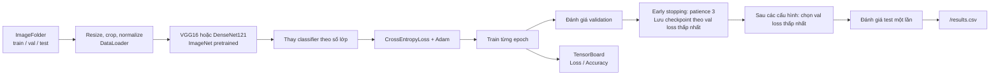

# Phân tích và hướng dẫn triển khai Thực hành 2

## 1. Mục tiêu và kết quả cần đạt

Bài thực hành dùng **transfer learning**: khởi đầu từ VGG16 hoặc DenseNet121 đã học đặc trưng trên ImageNet, thay lớp phân loại cuối để phù hợp với bộ dữ liệu mới, rồi huấn luyện đầu phân loại (hoặc fine-tune thêm khối cuối). Kết quả cần so sánh được:

- VGG16 và DenseNet121 trên cùng một bộ dữ liệu.
- Ảnh hưởng của learning rate `0.01` so với `0.001`.
- Ảnh hưởng của batch size `16` so với `32`.
- Loss và accuracy theo epoch trên train/validation; kết quả cuối trên test.

Đã chạy 4 cấu hình trong `outputs/reduced-experiments/results.csv`: hai mô hình × hai learning rate, batch size giữ cố định 16. Vì vậy đã so sánh kiến trúc và learning rate, nhưng **chưa so sánh batch size 16 với 32**. Mã nguồn triển khai nằm trong `data_loader.py`, `models.py`, `engine.py`, `main.py`. Chương trình ghi biểu đồ TensorBoard, checkpoint có validation loss thấp nhất, dùng early stopping (mặc định patience 3), và CSV kết quả trong thư mục do `--output-dir` chỉ định.

## 2. Vì sao cách làm này tạo ra kết quả

Mạng pretrained đã học các đặc trưng ảnh phổ thông như cạnh, hoa văn và hình dạng từ ImageNet. Thay lớp phân loại cuối giúp ánh xạ các đặc trưng đó sang đúng nhãn của bài toán mới. Mặc định, các lớp trích xuất đặc trưng được đóng băng và chỉ lớp phân loại mới được cập nhật; lựa chọn `--fine-tune-last-block` mở thêm khối cuối để thích nghi sâu hơn.

Ảnh được đưa về kích thước 224×224 và chuẩn hóa theo trung bình/độ lệch chuẩn ImageNet, phù hợp với trọng số pretrained. Augmentation ngẫu nhiên chỉ dùng cho train để giảm học thuộc; validation/test dùng phép biến đổi cố định để kết quả có thể so sánh. Cross entropy đo sai khác giữa dự đoán và nhãn; Adam cập nhật các tham số đang được huấn luyện.

Validation được đo ở mỗi epoch và dùng để chọn checkpoint/cấu hình theo validation loss. Các cấu hình tuning không được đánh giá trên test; sau khi chọn cấu hình tốt nhất bằng validation, test chỉ được chạy một lần. TensorBoard ghi metric train có augmentation, train-eval với transform cố định, và validation; CSV gom kết quả cấu hình.

### Sơ đồ luồng dữ liệu và huấn luyện



## 3. Dataset đề xuất, chuẩn bị dữ liệu và cài đặt

**Dataset đã tải và chuẩn bị: Oxford-IIIT Pet.** Bộ dữ liệu có 37 giống chó/mèo và được torchvision hỗ trợ. Dữ liệu đang có trong `dataset/`: `train` 2.941 ảnh, `val` 739 ảnh (tách phân tầng 80/20 từ split trainval chính thức), `test` 3.669 ảnh (giữ nguyên split test chính thức). Thư mục `dataset/_oxford_raw` lưu dữ liệu gốc tải về. Các ảnh trong các split được hard-link tới bản gốc để tránh nhân đôi dung lượng. Lưu ý đây là bài toán 37 giống, không phải chỉ phân loại chó/mèo.

Pipeline hiện đọc ảnh theo định dạng `ImageFolder`; dataset gốc cần được chia/chép thành các thư mục `train`, `val`, `test` theo tên giống. Dùng split `trainval` của Oxford-IIIT Pet để tách train/validation theo từng lớp; giữ split `test` chính thức để đánh giá cuối. Không chia ngẫu nhiên chung cả bộ rồi để ảnh test lọt vào train/validation.

Chương trình hiện dùng `torchvision.datasets.ImageFolder`, nên cần chuẩn bị ba tập tách biệt. Mỗi lớp là một thư mục con; tên và thứ tự lớp phải giống nhau ở cả ba split:

```text
dataset/
  train/
    class_a/
    class_b/
  val/
    class_a/
    class_b/
  test/
    class_a/
    class_b/
```

Đặt ảnh tương ứng vào từng thư mục lớp. Không đưa ảnh test vào train/validation. Từ thư mục có mã nguồn, cài dependency:

```powershell
.\.venv\Scripts\Activate.ps1
python -m pip install -r requirements.txt
```

Môi trường đã được tạo tại `.venv` với Python 3.12, PyTorch `2.14.1+cpu`, torchvision `0.29.1+cpu` và TensorBoard `2.21.0`. Muốn dùng CUDA, cần cài lại bộ PyTorch/torchvision đúng phiên bản CUDA và phần cứng theo hướng dẫn PyTorch; máy hiện tại đang dùng CPU. Lần tải dataset hoặc chạy pretrained lần đầu cần Internet.

## 4. Cách chạy

Chạy cả hai kiến trúc với một cấu hình:

```powershell
python main.py --data-dir .\dataset --epochs 5 --batch-size 16 --learning-rate 0.001
```

Chạy đầy đủ ma trận 2 learning rate × 2 batch size cho cả hai kiến trúc:

```powershell
python main.py --data-dir .\dataset --epochs 5 --tune
```

Tương đương tối đa 8 lần huấn luyện (2 mô hình × 4 cấu hình). Để fine-tune khối đặc trưng cuối:

```powershell
python main.py --data-dir .\dataset --epochs 5 --tune --fine-tune-last-block
```

Để giảm thời gian ban đầu, có thể chọn một model, ít epoch hơn hoặc danh sách cấu hình nhỏ hơn, ví dụ:

```powershell
python main.py --data-dir .\dataset --models densenet121 --epochs 2 --tune --learning-rates 0.001 --batch-sizes 16 32
```

Mở TensorBoard sau khi chạy:

```powershell
python -m tensorboard.main --logdir .\outputs
```

Truy cập địa chỉ local được TensorBoard in ra (thường là `http://localhost:6006`). Các tag `Loss/train`/`Accuracy/train` là metric trên ảnh train có augmentation; `Loss/train_eval`/`Accuracy/train_eval` và validation dùng transform cố định để so sánh công bằng hơn. `Loss/test` và `Accuracy/test` chỉ được ghi cho cấu hình chọn bằng validation.

## 5. Cách đọc và giải thích kết quả

| Quan sát | Diễn giải cần kiểm tra |
| --- | --- |
| Train loss giảm, validation loss cũng giảm | Mô hình đang học đặc trưng có ích và chưa thấy dấu hiệu overfit rõ. |
| Train-eval accuracy tăng nhưng validation accuracy đứng yên/giảm | Có thể overfit; so sánh `train_eval` với validation (cả hai dùng transform cố định), rồi xem thêm dữ liệu và các đường loss. |
| Loss dao động mạnh hoặc tăng | Learning rate có thể quá cao; kiểm tra dữ liệu và thử learning rate thấp hơn. |
| Batch size lớn hơn chạy nhanh hơn mỗi epoch nhưng chất lượng khác | So sánh cả thời gian, validation và test; batch size không bảo đảm accuracy cao hơn. |
| Fine-tuning cải thiện validation nhưng làm train chậm hơn | Nhiều tham số được cập nhật; cân nhắc lượng dữ liệu và nguy cơ overfit. |
| Mô hình có validation tốt nhưng test thấp hơn đáng kể | Có thể chênh lệch phân phối dữ liệu hoặc validation chưa đại diện; không chọn cấu hình chỉ bằng train accuracy. |

Accuracy được lưu ở dạng tỷ lệ 0–1 (ví dụ `0.85` là 85%). Đã chạy 4 cấu hình trong `outputs/reduced-experiments/results.csv`: VGG16 và DenseNet121, mỗi mô hình với LR `0.01` và `0.001`, batch size `16`, tối đa 5 epoch, patience 3. Cấu hình LR `0.001` được chọn cho cả hai mô hình theo validation loss; test accuracy lần lượt là 88,80% (VGG16) và 91,31% (DenseNet121). Chưa so sánh batch size 16 với 32, không chạy k-fold do chi phí huấn luyện cao trên CPU, và không kết luận từ một lần chạy là kết quả trung bình.

### Hình dung các đường cong kỳ vọng (minh họa, không phải số đo)

```text
Loss                           Accuracy
cao | \ train                  cao |          ─ validation
    |  \___                        |       __/
    |      \__ validation          |    __/
thấp+------------ epoch         thấp+------------ epoch
```

Đây chỉ là hình minh họa xu hướng thường mong đợi; đường thực tế có thể khác. Dùng biểu đồ TensorBoard của chính lần chạy để kết luận.

## 6. Chia việc triển khai và báo cáo cho 6 người

| Người | Phần phụ trách | Tệp/đầu ra cần bàn giao | Phụ thuộc và kiểm tra |
| --- | --- | --- | --- |
| **1 – Data Engineer** | Cài môi trường, thống nhất cấu trúc dataset, transforms và DataLoader train/val/test. | `requirements.txt`, `data_loader.py`, cấu trúc dataset đã thống nhất. | Xác nhận số lớp, tên thư mục lớp khớp giữa ba split; chạy thử một batch có shape `[N, 3, 224, 224]`. |
| **2 – Model Architect VGG** | Trọng số VGG16 pretrained, thay classifier, freeze backbone và tùy chọn mở khối cuối. | Phần `vgg16` trong `models.py`, số tham số trainable và kiến trúc in ra. | Thử forward một batch; output phải có shape `[N, số_lớp]`. |
| **3 – Model Architect DenseNet** | Trọng số DenseNet121 pretrained, thay classifier, freeze backbone và tùy chọn mở denseblock cuối. | Phần `densenet121` trong `models.py`, số tham số trainable và kiến trúc in ra. | Cùng giao diện và shape output với VGG để thay model không cần sửa engine. |
| **4 – Trainer & Evaluator** | CrossEntropyLoss, Adam, train/evaluate, accuracy và chọn checkpoint theo validation. | `engine.py` và phần train/evaluate trong `main.py`. | Loss tính theo số mẫu; đánh giá không cập nhật gradient; test chỉ chạy sau khi chọn checkpoint. |
| **5 – MLOps & Hyperparameter** | Ghi TensorBoard, chạy tuning và tổng hợp bảng. | Logging trong `main.py`, các event TensorBoard và CSV trong thư mục output. | Đã chạy 4 cấu hình (mỗi model × hai LR, batch size 16); chưa đối chiếu batch size 16 với 32. |
| **6 – Team Leader & Reporter** | Ghép pipeline, chạy thí nghiệm, tổng hợp so sánh kiến trúc/siêu tham số và thuyết trình. | `main.py`, checkpoint, CSV, ảnh chụp TensorBoard và báo cáo cuối. | Ghi cấu hình, thiết bị, số epoch và số liệu thực; không coi số minh họa trong tài liệu là kết quả thật. |

### Thứ tự tích hợp

```text
Người 1 chốt dữ liệu
        ↓
Người 2 + Người 3 hoàn tất model cùng giao diện
        ↓
Người 4 hoàn tất engine
        ↓
Người 5 kiểm tra TensorBoard và tuning
        ↓
Người 6 chạy toàn pipeline, kiểm tra CSV/checkpoint và viết kết luận
```

## 7. Danh sách kiểm tra trước khi nộp

- [ ] Ba split `train`, `val`, `test` có cùng các thư mục lớp và không bị trùng ảnh ngoài chủ đích.
- [ ] VGG16 và DenseNet121 đều trả đúng số logits theo số lớp.
- [ ] TensorBoard có loss/accuracy train, train-eval và validation theo epoch.
- [ ] Đối chiếu train-eval với validation để đánh giá overfitting; không so trực tiếp validation với train accuracy trên ảnh augmentation.
- [ ] So sánh các cấu hình bằng validation; chỉ báo cáo test của cấu hình đã chọn.
- [ ] Lưu cấu hình chạy, phiên bản thư viện, thiết bị, CSV kết quả và ảnh biểu đồ.
- [ ] Nêu hạn chế: dữ liệu, thời gian/thiết bị, số epoch và khả năng dao động giữa lần chạy.
